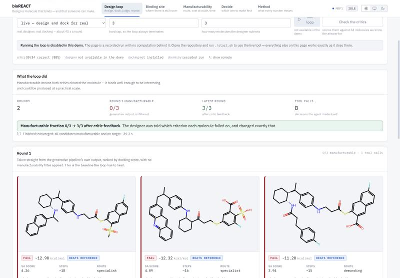
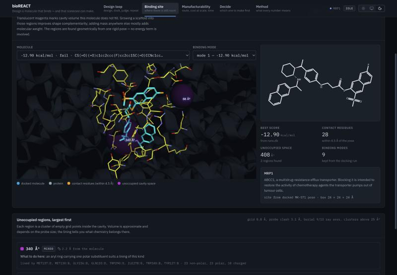
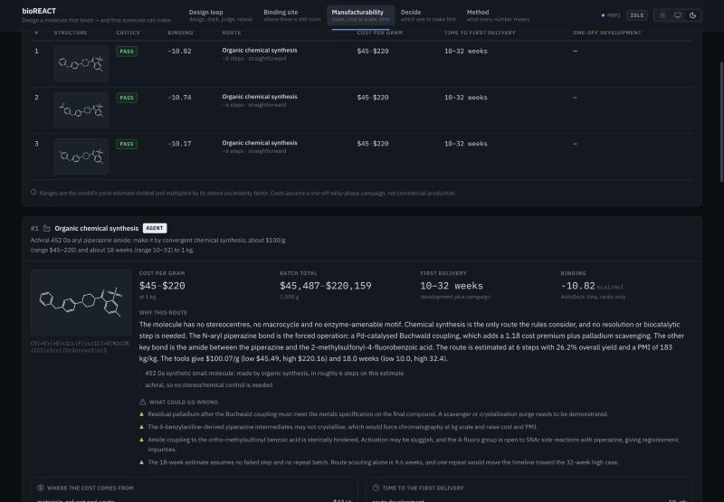
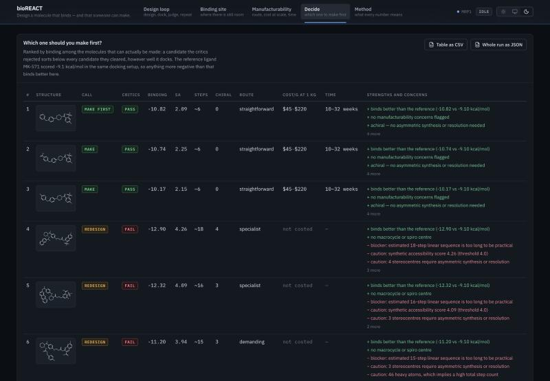

# bioREACT

**Design a molecule that binds — and that someone can actually make.**

Early-stage drug discovery ranks candidates on predicted binding and
drug-likeness. Whether a molecule can be produced at scale, what that would
cost and how long it would take usually comes later, after a medicinal
chemistry team has already committed to a series. bioREACT brings that
question forward into candidate selection.

It is one application with two halves that talk to each other:

| | |
|---|---|
| **The design loop** | An agent grows a small known binder into the unoccupied regions of the protein's binding cavity, docks each candidate with AutoDock Vina, and two deterministic critics judge whether it could be made. Rejections are structured — criterion, value, threshold, and the specific change that would fix it — and go straight back to the designer, which tries again. |
| **The manufacturability agents** | For every candidate the critics clear, an agent works out how it would be produced (ordinary synthesis, a chemo-enzymatic route with a named enzyme class, fermentation, or solid-phase peptide synthesis), what a gram would cost at the quantity you need, and how long the first delivery would take. |

The output is a side-by-side table that answers the question a project
meeting actually asks: **which of these should we make first?**

### [Open the demo →](https://ameliamcalister.github.io/bioREACT-Drug-design-and-manufacturability/)

The whole interface, running against a real recorded run: the molecules,
the critic rejections, the docked poses in 3D, the costs. Nothing to
install. Starting a *new* run needs the tools below, and the demo says so
where those buttons are.

| | |
|---|---|
|  |  |
| **Design loop** — each round, what the critics sent back and what the designer changed | **Binding site** — the docked pose with the cavity space it leaves empty, in magenta |
|  |  |
| **Manufacturability** — route, cost per gram and time, itemised | **Decide** — ranked, with an explicit call and the evidence behind it |

```
            ┌──────────────────────────────────────────┐
            │                                          │
            ▼                                          │
     Designer agent ──▶ Docking ──▶ Synthesisability ──┤ structured
      (grows into          │          and process      │ rejection
       empty cavity        │             critics       │ reasons
       space)              │                │          │
                           │                ▼          │
                           │         shortlist ────────┘
                           │                │
                           ▼                ▼
                   binding score    Route · cost at scale · time
                           └───────────────┬┘
                                           ▼
                                   Which one to make first
```

That return path is the point. Most systems are a straight line: design,
check, done. This one is a circle, and the thing it circulates is the
reason a molecule was rejected.

---

## Run it

```bash
./start.sh
```

Then open **http://localhost:3000**.

One command starts both processes: the Python service that owns the
chemistry (port 8000) and the interface that proxies it (port 3000).
Ctrl-C stops both, and re-running the script is safe — it frees both ports
first.

### First run on a new machine

```bash
pip install -r loop/requirements.txt
```

```bash
cd loop && python3 doctor.py
```

`doctor.py` checks every dependency and prints the exact command for
anything missing. `start.sh` installs the Node packages itself the first
time.

### Nothing installed? Run it offline

Pick **offline demo** mode and press **Run loop**. No API key, no docking
software, about five seconds. It replays the loop over docking results
committed to this repository, and the manufacturability side has a
**rules only** switch that produces the same figures without a model.

---

## What you need

| | why | install |
|---|---|---|
| Python 3.10+ with **rdkit**, **httpx**, **numpy**, **scipy** | chemistry, descriptors, cavity geometry | `pip install -r loop/requirements.txt` |
| **Node 18+** | the interface | `brew install node` |
| **Open Babel** | SMILES → 3D structure | `conda install -c conda-forge openbabel` |
| **AutoDock Vina** | the docking engine | `brew install autodock-vina` |
| Claude API key | the designer and the manufacturability agents | `cp loop/.env.example loop/.env`, add your key |

The last two cannot be installed by pip. If they live somewhere unusual,
set `VINA_PATH` / `OBABEL_PATH`.

---

## The five screens

**Design loop** — run it, then watch each round: what came back from the
critics, what the designer changed in response, and the candidates it
produced. Every rejection shows the number it broke and the change that
would fix it. The tool-call trace is there too, because what makes this an
agent rather than a script is that the model chooses which molecules to
propose, which to spend a docking run on, and when it has enough.

**Binding site** — the docked pose inside the protein, with the cavity
volume the molecule does *not* fill drawn as translucent spheres, sized by
volume and labelled with the residues lining them. This is the space the
designer grows into, and it is computed, not asserted: a grid is laid over
the site, points too close to protein or to the ligand are discarded,
points not enclosed on enough ray axes are discarded as solvent, and what
is left is clustered.

**Manufacturability** — route, cost per gram at 10 g to 10 kg, and weeks to
first delivery, per candidate. Every figure is itemised: process mass
intensity against material cost, operator-days against day rate, and the
premiums the structure forces on you (palladium coupling, chiral
resolution, chromatography). Every assumption behind them is editable on
the page, and re-estimating with your own numbers takes one click.

**Decide** — the side-by-side table, ranked, with an explicit call of
`MAKE FIRST`, `MAKE`, `BACKUP`, `REDESIGN` or `DO NOT MAKE` and the
strengths and concerns behind it. Exports to CSV, or the whole run to JSON.

**Method** — the critics' thresholds, the published rule sets with their
citations, every cost assumption with its provenance, how the cavity
analysis works, how accurate the critics are, and a plain list of what the
tool cannot do.

The interface follows your system's light or dark setting, and the control
in the top right overrides it either way. Structures are redrawn in a
palette that matches.

---

## What a run produces

Against MRP1 (ABCC1, a multidrug-resistance efflux transporter), starting
from real generative output:

| round | source | manufacturable | best binding |
|-------|--------|----------------|--------------|
| 1 | generative pipeline output, unfiltered | **0/3** | −12.90 kcal/mol, ~18 steps |
| 2 | designer, after critic feedback | **3/3** | −10.82 kcal/mol, ~6 steps |

The round-2 molecules beat the reference MRP1 inhibitor MK-571 (−9.1
kcal/mol in the same setup) on a far shorter route.

**The finding:** docking score and manufacturability are anti-correlated
here. The three best-docking molecules in the source data are the three the
critics reject — the best of them would need an estimated eighteen steps,
which is not a manufacturing route, it is a research project.

### How accurate are the critics?

Measured against molecules whose makeability is known from how they are
actually produced:

| tier | what it contains | accuracy |
|------|------------------|----------|
| easy | marketed small-molecule drugs vs natural products | 23/23 = 100% |
| **hard** | **complex marketed drugs vs plausible rejects** | **7/11 = 64%** |
| combined | | 30/34 = 88% |

Press **Check the critics** to reproduce it. The easy tier is not evidence
of much — those two groups separate on molecular weight alone — and the
interface says so next to the number. The hard tier is the honest figure,
and every molecule it got wrong is named.

---

## Use your own protein

Press **Use your own protein**, upload a receptor (`.pdb` is converted for
you) and a reference ligand.

**The reference ligand decides where on the protein you dock.** Give it a
pose file — the ligand from the crystal structure as `.pdb`, `.sdf` or
`.mol2` — and the grid is boxed tightly around it. Without one it docks
blind against the whole protein: slower and far less reliable. A SMILES
string names the molecule but has no coordinates, so it cannot do this job.

If the ligand is already inside your PDB:

```bash
grep "^HETATM" structure.pdb | grep " AQ4 " > ligand.pdb
```

### A second protein, set up this way

The repository ships a second target prepared through exactly that form:
the **EGFR kinase domain** (PDB 1M17, 2,560 atoms) with its co-crystallised
erlotinib as the reference pose. Nothing in the code changed between the
two proteins.

Docking erlotinib itself through the same pipeline scores it at −6.99
kcal/mol, which becomes the comparison for everything else. In one run the
designer read the cavity gaps beside that pose and grew the quinazoline
into the largest of them, submitting three candidates at −8.97, −8.25 and
−7.86 kcal/mol — all better than the reference, all **3/3 manufacturable**
at about six steps. The loop then stopped and said why: every candidate
could be made, but none reached the −9.0 kcal/mol affinity target it was
given. That is the honest outcome, and it is the one the interface
reports.

---

## Layout

| path | what |
|------|------|
| `start.sh` | starts both halves |
| `loop/orchestrator.py` | the loop and the feedback edge |
| `loop/designer_agent.py` | the designer: tools, budget, run log |
| `loop/critics.py` | **the rubric** — edit the thresholds here |
| `loop/pocket.py` | unoccupied cavity space beside a docked pose |
| `loop/manufacture.py` | **the cost, route and time model** — every assumption is in `ASSUMPTIONS` |
| `loop/manufacture_agent.py` | the manufacturability agents and their tools |
| `loop/admet.py` | Lipinski, Veber, Ghose, Egan, QED, PAINS and Brenk |
| `loop/chembl.py` | published binders and analogues, with an offline cache |
| `loop/compare.py` | the decision table |
| `loop/eval_set.py` | ground truth for the critics, and the confusion matrix |
| `loop/serve.py` | the JSON API |
| `loop/tests/` | 51 tests: `cd loop && python3 -m pytest` |
| `bioreact-app/` | the interface (React, Vite, Express) |
| `bioreact-app/src/index.css` | the design tokens — both themes come from here |
| `loop/build_demo.py` | freezes a run into the static demo |
| `.github/workflows/` | the test run, and the Pages deploy |

---

## Honest limitations

- **The estimated step count is a heuristic** from rings, stereocentres and
  heavy atoms — not a retrosynthesis. No reaction is ever proposed, so no
  real route is costed. It is labelled an estimate everywhere it appears.
- **The cost model is uncalibrated.** Its factors sit inside published
  ranges for early-phase pharmaceutical manufacture, but none of them has
  been checked against real process data. Read the ranking between
  candidates, not the absolute figure, and move the assumptions yourself —
  the interface exists partly to make that easy. Validating these against
  real process data is the obvious next piece of work.
- Costs price a one-off early-phase campaign in a kilo-lab or at a contract
  manufacturer. A compound made by the tonne in a dedicated plant costs
  orders of magnitude less per gram than anything quoted here.
- **Biocatalysis is proposed from a substructure match.** It says the
  chemistry is plausible for a named enzyme class, not that an enzyme
  accepts this substrate. Screening a panel is the first experiment.
- Building-block availability is approximated from elements and halogen
  density, not a supplier catalogue.
- **Docking ranks; it does not predict affinity.** Rigid receptor, one
  grid, no rescoring. Vina is stochastic — repeat runs of one molecule
  varied by 0.17 kcal/mol here for a rigid candidate and 1.51 for the
  flexible reference.
- The cavity analysis is geometry from a single rigid pose. No energy term,
  no receptor flexibility, and volumes depend on the probe size.
- **There is no trained ADMET model anywhere in this project.** The
  property screen applies published rule sets and structural alerts, which
  filter on physicochemistry and do not predict what a molecule does in an
  animal.
- The critics are deterministic rules, not a model — deliberately, so that
  every rejection points at a number and a threshold you can defend or
  change.
- **No synthesis or fermentation is ever carried out.** Every output is a
  proposal for a person to approve.

---

## Credits

Built at the UCL × Gemini hackathon (biotech stream) by Amelia McAlister,
Jasmine Barry and Aditya K. The design loop extends the iterative AI drug
design work from Amelia's dissertation project at Imperial.

Docking: AutoDock Vina. Structure handling: RDKit and Open Babel. Synthetic
accessibility: the Ertl & Schuffenhauer SA score shipped with RDKit.
Structural alerts: PAINS (Baell & Holloway) and the Brenk set, from RDKit's
filter catalogue. Published activity and analogue data: ChEMBL (EMBL-EBI),
CC-BY-SA 3.0, through the public REST API.

---

## Publishing the demo

The demo page is the same interface with a recorded run bundled into it,
so it needs no server:

```bash
cd bioreact-app && npm run demo
```

That freezes the current run (`loop/build_demo.py`) into
`bioreact-app/public/demo/` and builds the static site into
`bioreact-app/dist/`. Check it locally with `npm run preview`.

Pushing to `main` deploys it through `.github/workflows/pages.yml`. The
one thing that cannot be done from here is switching Pages on: in the
repository, **Settings → Pages → Source: GitHub Actions**, once.

To publish a different run, run the loop and the agents, then `npm run
demo` again and commit the result.
